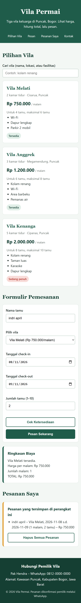

# Vila Permai – Aplikasi Pemesanan Vila

- **Nama:** Indri Aprilianti Safitri
- **NIM:** 24011130493
- **Nama repository:** uts-vila-permai-5B24011130493
- **Deskripsi:** Ujian Tengah Semester – Teknologi Web: Aplikasi Pemesanan Villa

Halaman web statis (HTML, CSS, JavaScript) untuk memesan tiga vila di kawasan Puncak, Bogor. Tidak memakai server maupun basis data.

## Cara Menjalankan
1. Unduh atau clone repository ini.
2. Buka file `index.html` dengan browser (Chrome, Firefox, atau Edge).

## Fitur yang Sudah Selesai
- [x] Tiga kartu vila dirender dari array objek JavaScript
- [x] Pencarian vila berdasarkan nama, lokasi, atau fasilitas
- [x] Dropdown pilihan vila terisi otomatis dari data
- [x] Cek ketersediaan (status vila dan tanggal bentrok)
- [x] Total biaya otomatis sebelum tombol pesan ditekan
- [x] Validasi form dengan pesan berbahasa Indonesia
- [x] Nama terakhir dan daftar pesanan tersimpan di localStorage
- [x] Tampilan responsif (breakpoint 768px dan 480px)

## Fitur yang Belum Selesai
- [ ] Pembayaran online
- [ ] Pengiriman pesanan otomatis ke WhatsApp pemilik
- [ ] Foto vila

## Rumus Biaya
Total = (harga per malam + tamu tambahan x biaya tambahan) x jumlah malam

## Tangkapan Layar

## Deskripsi
**Demo (GitHub Pages):** https://aprilindri344-cell.github.io/uts-vila-permai-5B24011130493/